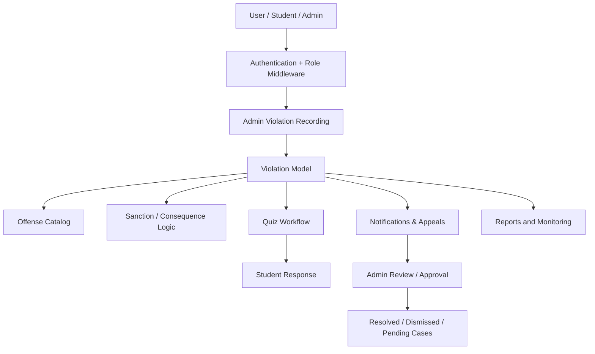

# System Architecture and Workflow Report

## Executive summary

This VMS project is a role-based student discipline and compliance platform built on Laravel. The architecture is centered on a single discipline workflow:

1. A student record is created and assigned a role.
2. An admin records a violation against a student.
3. The violation is classified by offense type and sanction path.
4. The system evaluates whether consequence approval or a penalty quiz is required.
5. The student can respond, appeal, or resolve the case.
6. Admins review, approve, and close the case.

The system already has the correct foundations for a compliance workflow: role middleware, violation records, offense cataloging, quiz-based interventions, notifications, and admin dashboards. The biggest opportunity is operational governance: standardizing the workflow, clarifying ownership, and reducing scattered business logic between controllers, models, and inline route logic.

## Architecture map

## Core system domains

### 1. Auth and access control

- The app uses Laravel authentication and custom middleware for admin and student isolation.
- Authentication routes live under `routes/auth.php` and access restrictions are enforced in `routes/web.php`.
- `User` carries the role model and profile metadata used across the app.

Key files:
- `app/Models/User.php`
- `app/Http/Middleware/AdminMiddleware.php`
- `app/Http/Middleware/StudentMiddleware.php`
- `routes/auth.php`
- `routes/web.php`

### 2. Violation registry

- The central transactional model is `Violation`.
- It stores the student relationship, offense code, category, number, consequence status, and resolution details.
- The model centralizes key discipline logic such as case IDs and sanctions.

Key files:
- `app/Models/Violation.php`
- `database/migrations/2026_09_04_025012_create_violations_table.php`
- `database/migrations/2026_10_18_075740_add_offense_fields_to_violations_table.php`

### 3. Offense catalog and sanction rules

- Offenses are stored in the `offenses` table through the `Offense` model and validated in the `config/offenses.php` source of truth.
- Sanction paths and categories drive consequence logic for each offense.

Key files:
- `app/Models/Offense.php`
- `config/offenses.php`
- `app/Http/Controllers/OffenseController.php`

### 4. Consequence and quiz enforcement

- The violation lifecycle includes `pending`, `consequence_applied`, `resolved`, and `dismissed` states.
- Quizzes are generated for violations requiring student explanation or compliance acknowledgment.
- Admin approvals and appeals are tracked separately from case status.

Key files:
- `app/Models/Quiz.php`
- `app/Models/QuizAttempt.php`
- `app/Http/Controllers/PenaltyQuizController.php`
- `app/Http/Controllers/ConsequenceController.php`
- `app/Http/Controllers/AdminAppealController.php`

### 5. Reporting and monitoring

- There are multiple admin reporting views, recent-case views, and student-facing monitoring pages.
- Reporting logic is spread between controllers and views, but the main pattern is consistent: fetch filtered violations and present them in dashboard-style pages.

Key files:
- `app/Http/Controllers/ViolationController.php`
- `app/Http/Controllers/StudentViolationController.php`
- `app/Http/Controllers/ReportController.php`
- `app/Http/Controllers/RecordViolationController.php`

## Current workflow

### Student-facing flow

1. Student logs in and sees dashboard information.
2. Student can review violation history and report status.
3. If a case reaches a consequence state, a quiz becomes available.
4. Student submits a response, which is reviewed by admin.

### Admin-facing flow

1. Admin reviews a student or violation record.
2. Admin records a violation with offense classification and location.
3. System calculates sanction path, offense count, and case ID.
4. Admin approves or reviews a consequence, resolves the matter, or dismisses the case.
5. Notifications are sent to the student and relevant administrative users.

## Operational strengths

- Clear separation between admin, student, and shared routes.
- A strong domain model around violations and sanctions.
- Role-based access control is already in place.
- The product already supports a full discipline lifecycle: record → review → consequence → quiz → resolution.
- Notification-driven communication is available through Laravel notifications and admin dashboards.

## Workflow and management gaps

### 1. Business rules are spread across layers

Important logic is currently split between:
- controllers
- model accessors
- route-level closures
- config-driven offense rules

This makes the system harder to manage over time because the state machine is not centralized. One team member may update a controller while another updates the sanction config without a common process.

Recommendation:
- Introduce a service layer for violation lifecycle actions and decision handling.
- Centralize the status state machine in one place.
- Keep controller methods thin and route definitions declarative.

### 2. The workflow relies on informal state naming

The app uses statuses like `pending`, `consequence_applied`, `resolved`, and `dismissed`, but some user-facing labels and filters map different semantics.

Recommendation:
- Define a formal lifecycle and map every status to a single canonical meaning.
- Add a state diagram and enforce it in validation rules and service methods.
- Ensure every admin dashboard view references the same state definition.

### 3. Routes and responsibilities are not fully normalized

Multiple admin features are mixed into `routes/web.php`, including:
- violation management
- notifications
- reports
- consequences
- appeal review
- profile operations

Recommendation:
- Split route groups into feature-specific modules or route files.
- Keep admin-specific work under a single domain boundary.
- Create explicit route names and policy classes for admin/student permissions.

### 4. Reporting and governance can be improved

Current reporting is functional but not managed like a formal operational dashboard. The system needs stronger owner accountability, metrics, and auditability.

Recommendation:
- Define a weekly operational report covering:
  - total active violations
  - open cases by category
  - unresolved consequence queues
  - appeal backlog
  - student response completion rate
  - admin resolution time
- Add a central review board or admin checklist for high-risk cases.

### 5. Data quality and compliance controls need stronger guardrails

The project already validates required fields, but the discipline domain is high-risk and sensitive. Operations need stronger records management.

Recommendation:
- Require case evidence attachment or notes for serious cases.
- Add immutable audit columns for created/updated metadata.
- Track which admin recorded or approved each case.
- Keep an escalation path for severe offenses and recurring violations.

## Recommended system management model

### Governance plan

1. One source of truth for offense definitions
   - Keep `config/offenses.php` and the `offenses` table synchronized.
   - Add a review process before changing sanction paths.

2. One source of truth for violation lifecycle
   - Put all status transitions inside a dedicated service or state machine.
   - Prevent updates that skip required review steps.

3. One admin operations workflow
   - Define a standard process for recording, reviewing, resolving, and closing violations.
   - Create a checklist for each offense category.

4. One accountability dashboard
   - Track operational KPIs by week/month.
   - Assign an owner to each dashboard metric.

### Core operational practices

- Use migrations for schema changes and freeze production data contracts.
- Keep seeders for demo/testing only; avoid production seed data drift.
- Back up records and archive older cases semantically.
- Add automated tests around violation lifecycle transitions and admin policy gates.

## Recommended next steps

### Phase 1: Stabilize the domain model
- Centralize violation-state transitions
- Standardize audit fields and admin ownership
- Consolidate offense definitions and sanction mapping

### Phase 2: Improve operational workflow
- Split route groups by feature
- Add admin KPI dashboard and review queue
- Add clearer notifications and escalation paths

### Phase 3: Strengthen system governance
- Enforce policy classes and role-based permission checks
- Add reporting and retention management
- Review the admin workflow quarterly with compliance owners

## Conclusion

The project is structurally strong and already reflects a disciplined, compliance-oriented design. The best improvement is not to rebuild the app, but to move from a feature-oriented implementation to a governed operational system: one lifecycle, one offense source of truth, one admin workflow, and one reporting model. That will make the platform easier to manage, more consistent for staff, and more resilient as the number of cases grows.
